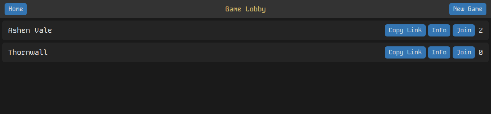
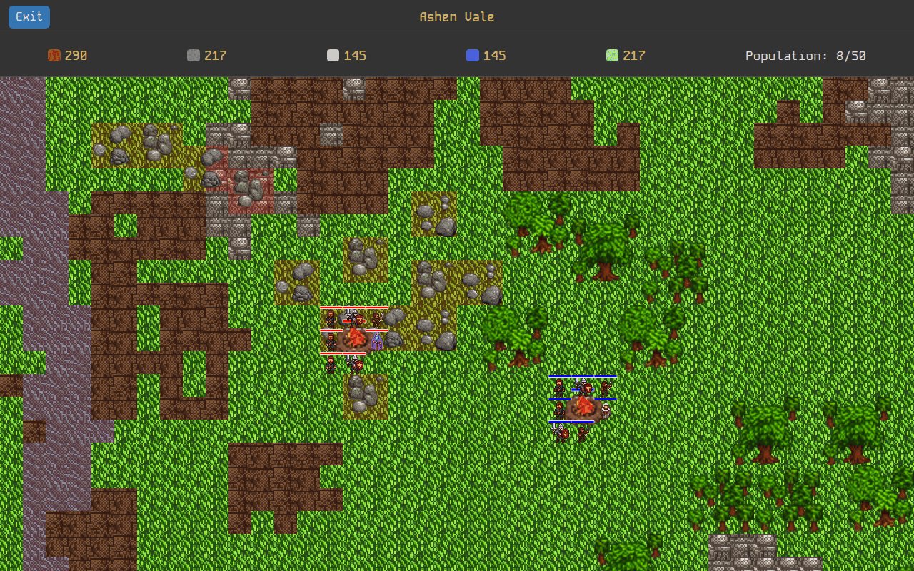

# Sorcery & Savagery

A medieval fantasy RTS for the browser: pick a starting party, gather wood, stone, iron, water and food, and build out from a campfire, against other players on the same map. Built with Bun, Phaser 3 and [web-game-framework](https://github.com/fatlard1993/web-game-framework).

## Setup

> Prerequisite: [Bun](https://bun.sh/docs/installation) must be installed

1. `git clone git@github.com:fatlard1993/sorcery-and-savagery.git`
2. `cd sorcery-and-savagery && bun install` (this also builds the client)

## Play

`bun start`

Then open [http://localhost:3040](http://localhost:3040). Options: `--port`/`-p` (or the `PORT` env var) and `--database`/`-d` (default `~/.sorcery-and-savagery.json`). `bun run db:clean` deletes the default save file.

Create a game or join one from the lobby, name yourself, pick 7 individuals for your starting party (workers, warriors, archers, mages, healers), then on the map:

- Click, shift-click or drag a box to select units; Escape deselects
- Click the map with units selected for a radial menu: Move or Build on open ground, Gather on a resource (a forest offers Food or Wood), Build on a site still under construction
- Ctrl+1-9 saves a control group, 1-9 recalls it
- WASD, the arrow keys or the mouse wheel pan the camera

## Dev

`bun dev` runs the server with hot reload and rebuilds the client on change (type `b` to rebuild, `stop` to quit); `bun run dev:clean` does the same from an empty save. `bun test` runs the tests.

## Current state

Early and unfinished. Working: the lobby, the starting party, the generated map, unit selection and movement, gathering, building placement, and a server game loop that saves to disk.

Not built yet:

- **Spawn location picker.** A player who has chosen a party waits with it pending until a spawn location is chosen, but the client has no screen for it yet, so a new player sees the map with no campfire or units. The server's `POST /games/:gameId/players/:playerId/spawn` takes a `position` (the screenshot's players were spawned that way).
- **Unit production.** The server queues it; nothing in the client asks for it.
- **Building range.** Buildings can go anywhere, not within reach of the campfire.

Known bugs (from [TODO.md](./TODO.md)): units can spawn on impassable terrain and stay stuck, the building preview sits a little off the real site, box selection has dead space, and resource and building variants aren't saved, so they can differ between players and reloads.

## License

Code is GPL-3.0-or-later; see [LICENSE](./LICENSE) for the code and asset terms.
